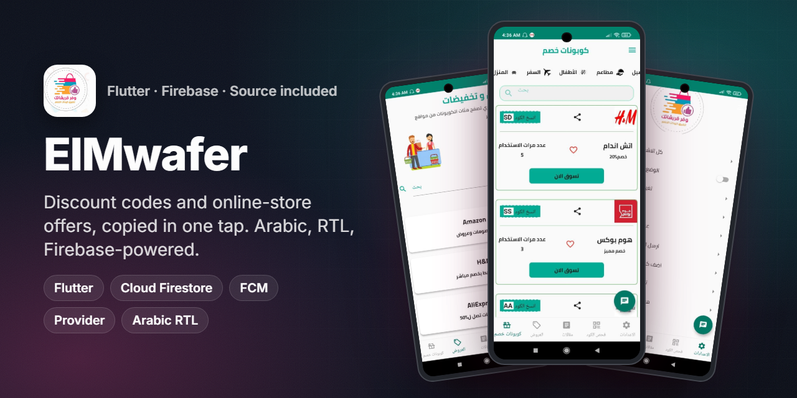
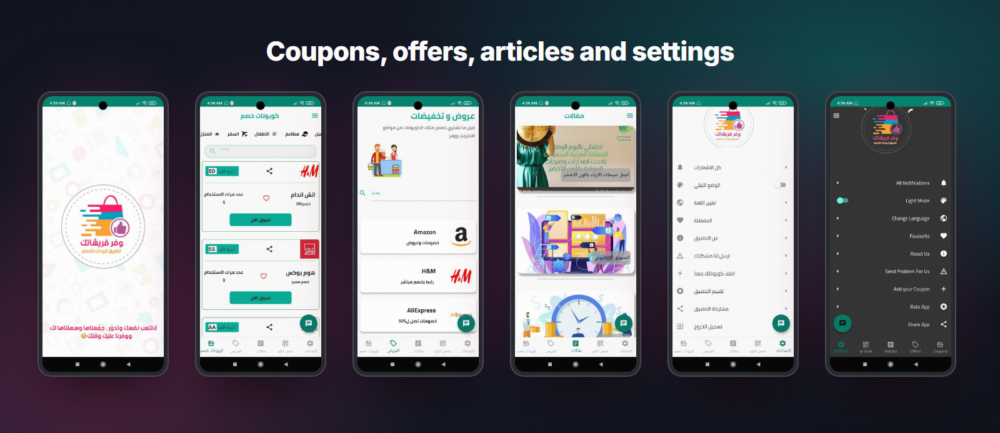
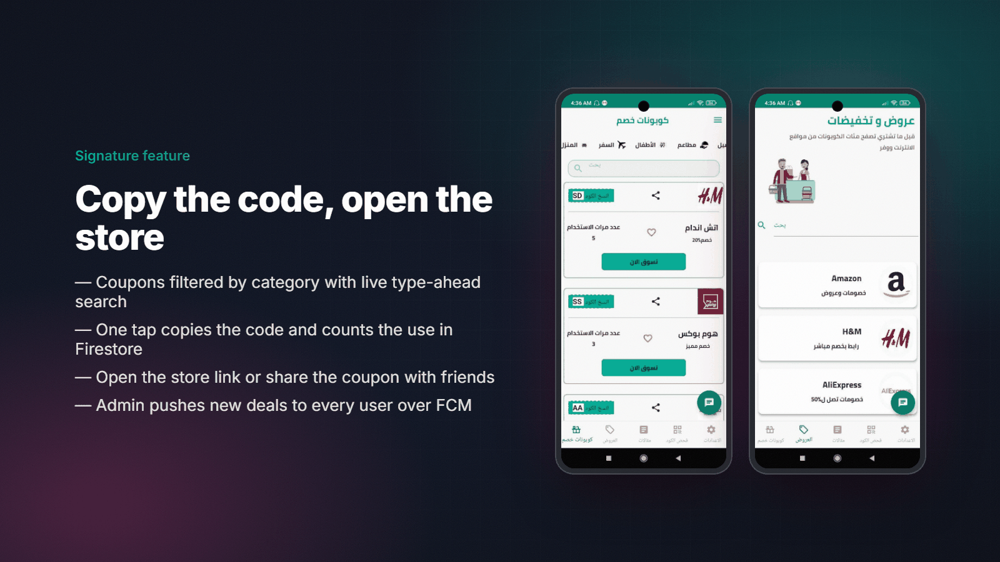
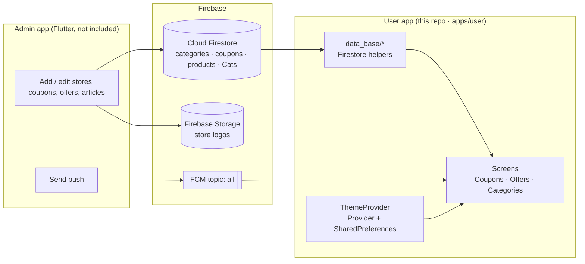

<p align="center"></p>
<h1 align="center">ElMwafer · وفر قريشاتك</h1>
<p align="center"><b>Discount codes and online-store offers, copied in one tap. An Arabic coupon app built with Flutter and Firebase.</b></p>
<p align="center">
  
  
  
  
  
  
</p>

## Overview

**ElMwafer** (*وفر قريشاتك*, "save your money") is a coupon and deals app for Arabic-speaking shoppers in Saudi Arabia and the Gulf.
It lists discount codes for well-known online stores (fashion, home, travel, restaurants, kids and more), lets the user copy a code
in one tap and opens the store, and shows store-wide offers and shopping articles.

| | |
|---|---|
| **Product** | User app (Android and iOS) + a separate Firebase admin app |
| **My role** | Flutter developer: built and shipped the user app and adapted the admin app for coupons, stores, articles and push notifications |
| **Timeline** | 2021 (first commit May 2021, last update September 2021) |
| **Store ID** | Published on Google Play as `com.wafer.qrushatak` (listing no longer available) |

This repository contains the **user app source code** in [`apps/user`](apps/user).

## The challenge

- Coupon codes were **scattered across social media posts**, and many had expired by the time a shopper found them.
- The operator needed to **add stores, coupons and offers without shipping an app update**, and to tell users about new deals right away.
- The audience reads Arabic, so the whole experience had to be **RTL first** with an Arabic typeface.

## Highlights

**🏷️ Coupons**
- Category strip (restaurants, travel, kids, home and more) with a coupon list for each category
- Live **type-ahead search** over stores, backed by Firestore range queries
- Coupon card with the store logo, the discount, the code and a **use counter**
- **Copy code** button that copies to the clipboard and increments the store's `click` counter in Firestore
- **Shop now** opens the store link; **Share** sends the deal with a link to download the app

**🛍️ Offers**
- Store offers list (Amazon, H&M, AliExpress, ...) loaded from Firestore, with its own search
- Each offer opens the store page in the browser

**🔔 Engagement**
- Firebase Cloud Messaging: every device subscribes to the `all` topic, so the admin app can push a new deal to all users
- Vibration feedback when a push arrives in the foreground

**⚙️ App shell**
- Onboarding (`introduction_screen`) shown once, using a flag stored in `shared_preferences`
- Side drawer: light/dark theme switch (Provider + `shared_preferences`), contact on WhatsApp, rate the app, share the app
- Arabic UI with Google Fonts *Cairo* and a custom curved app bar

## Screens

<p align="center"></p>
<p align="center"><sub>Splash, coupons, offers, articles, settings and the drawer, from the released build.</sub></p>

> Screenshots are from the released app. The released build also had an articles tab, a QR scanner and in-app chat. Those screens
> are not in the source snapshot in this repository, which covers coupons, offers, categories and the app shell.

## Signature feature

<p align="center"></p>

The coupon card is the core of the app ([`CouponsScreen.dart`](apps/user/lib/Coupons/CouponsScreen.dart)):

1. The list is a Firestore query on `coupons` filtered by the selected category.
2. **Copy code** first updates the store's `click` field in Firestore, then copies the code with `FlutterClipboard` and shows a snackbar.
   The use counter on each card therefore comes from real taps.
3. **Shop now** checks `canLaunch` before opening the store URL and shows a snackbar if the link is broken.
4. **Share** builds an Arabic message with the store name, the discount and a link to download the app.

## Architecture & stack



| Layer | Tech (from `apps/user/pubspec.yaml`) |
|---|---|
| UI | Flutter (Material), `google_fonts` (Cairo), `introduction_screen`, `dotted_border` |
| Navigation | `GetMaterialApp` (GetX) with named routes for onboarding and splash |
| State | `setState` per screen, `provider` (`ChangeNotifier`) for the theme |
| Data | `cloud_firestore` 0.12, `firebase_storage` 3.0 |
| Search | `flutter_typeahead` with Firestore `>=` / `<` prefix queries |
| Messaging | `firebase_messaging` 6.0.9 (topic `all`), `vibration` |
| Utilities | `clipboard`, `url_launcher`, `share`, `launch_review`, `shared_preferences` |

## Engineering notes

- **Prefix search on Firestore.** Firestore has no `LIKE` query, so store search uses a range query:
  `where('category', isGreaterThanOrEqualTo: q).where('category', isLessThan: q + 'ي')`. The last Arabic letter `ي` acts as the upper bound,
  which matches every Arabic store name that starts with the query.
- **Counting real usage.** The copy action writes the click counter first and copies the code in `whenComplete`, so the counter reflects real taps.
- **Content without releases.** Stores, coupons, offers and articles all live in Firestore and are edited from the admin app, so new deals appear without a store update.
- **One-time onboarding.** `main()` reads an `initScreen` flag from `shared_preferences` before `runApp` and picks the first route (`first` for onboarding or `/` for splash).
- **Theme persistence.** `ThemePreference` stores the dark-mode choice and `ThemeProvider` notifies `GetMaterialApp` to rebuild with the light or dark `ThemeData`.

## Getting started

> This is a **2021 codebase**. It targets **Flutter 2.0–2.2** in legacy (non-null-safe) mode (`sdk: ">=2.7.0 <3.0.0"`, `cloud_firestore` 0.12,
> `firebase_messaging` 6.0.9). It does not resolve on Flutter 3 / Dart 3 without a null-safety migration.
>
> **Verified:** with Flutter **2.10.5**, `flutter pub get` resolves and `flutter analyze` reports **0 errors and 0 warnings** (41 info-level lints).

```bash
# Use a Flutter 2.x SDK (for example with fvm)
fvm install 2.2.3 && fvm use 2.2.3

cd apps/user
cp android/app/google-services.json.example android/app/google-services.json   # then paste your Firebase config
fvm flutter pub get
fvm flutter run --dart-define=SUPPORT_WHATSAPP=9665XXXXXXXX
```

## Project structure

```
elmwafer/
├── apps/
│   └── user/                    # Flutter user app (source)
│       ├── lib/
│       │   ├── main.dart        # Firebase messaging, theme provider, routes
│       │   ├── HomePage.dart    # Entry cards: coupons and offers
│       │   ├── Coupons/         # Coupon list, copy / share / shop
│       │   ├── Offers/          # Store offers + search
│       │   ├── Categories/      # Category grid and category products
│       │   ├── data_base/       # Firestore helpers (stores, products, categories)
│       │   ├── WelcomeScreen/   # Splash and onboarding
│       │   └── widget/          # Drawer, theme provider, dialogs, animated button
│       ├── assets/              # Logo, onboarding art
│       └── android/ · ios/
└── assets/                      # README images (+ _src/render.json)
```

## State management

The app predates the author's later Bloc/Cubit work and keeps state simple:

- **Screen state:** `StatefulWidget` + `setState` (scroll-aware headers, search results, Firestore futures).
- **App state:** one `ThemeProvider extends ChangeNotifier` exposed with `ChangeNotifierProvider` and consumed at the root to switch themes.

## Configuration

| What | Where | Committed? |
|---|---|---|
| Firebase Android config | `apps/user/android/app/google-services.json` (copy from `.example`) | No (git-ignored) |
| Firebase iOS config | `apps/user/ios/Runner/GoogleService-Info.plist` | No (git-ignored) |
| WhatsApp support number | `--dart-define=SUPPORT_WHATSAPP=...` | No |

Firestore collections used by the app: `categories` (stores and coupons), `coupons`, `CouponScreen`, `Cats`, `products`.

## About the admin app

The operator managed content with a separate Flutter + Firebase admin app: add, edit and re-publish coupons, stores, categories,
offers and articles, and send push notifications to the `all` topic over the FCM HTTP API. It is **not included** here because it was
built on an open-source admin template by another developer
([ahmedeidd/Admin-Shop-App](https://github.com/ahmedeidd/Admin-Shop-App)). Only original work is published in this repository.

## Results

- Published on Google Play as `com.wafer.qrushatak`. The listing is no longer live, so no install numbers are claimed.

## Contributing

This is a portfolio snapshot. Issues and suggestions are welcome. A null-safety migration to current Flutter would be the most useful contribution.

## License

Source is shared for portfolio and learning purposes. All rights reserved by the author unless agreed otherwise. Store names and logos in the screenshots belong to their owners.

## بالعربي

**وفر قريشاتك (ElMwafer)** تطبيق كوبونات وعروض للمتسوقين في السعودية والخليج.
بيعرض أكواد خصم لأشهر المتاجر حسب القسم. بضغطة واحدة تنسخ الكود (ويتسجّل عدد مرات الاستخدام في Firestore) وتفتح المتجر أو تشارك الكوبون.
المحتوى كله بيتدار من تطبيق أدمن من غير تحديثات للتطبيق، والعروض الجديدة بتوصل للمستخدمين بإشعارات FCM.
مبني بـ Flutter وFirebase بواجهة عربية كاملة ووضع داكن. الكود الموجود هنا هو كود تطبيق المستخدم.

## Links

- Source: [`apps/user`](apps/user)

---
<h3 align="center">Built by Mahmoud Shaker — Senior Flutter Engineer</h3>
<p align="center">
  <a href="https://wa.me/201140279111"></a>
  <a href="https://www.linkedin.com/in/anashaker/"></a>
  <a href="https://anashaker.github.io/shaker_portfolio/"></a>
  <a href="mailto:mahmoudshaker382001@gmail.com"></a>
  <a href="https://khamsat.com/user/sheko201566"></a>
  <a href="https://mostaql.com/u/ShekoShaker"></a>
  <a href="https://github.com/ANaSHaker"></a>
</p>
